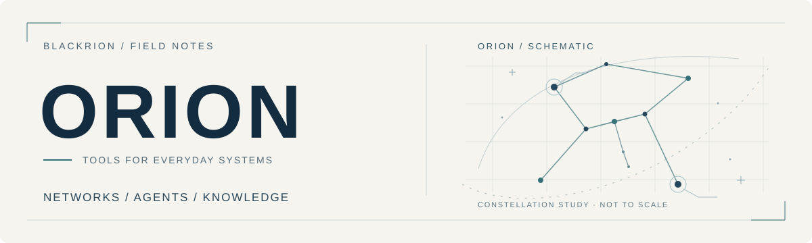
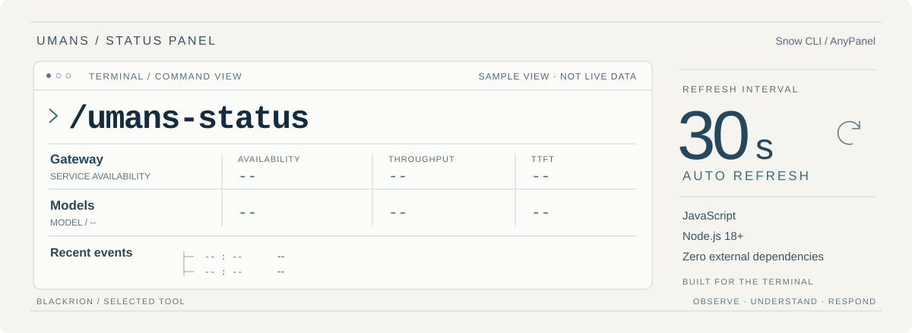

<picture>
  <source media="(prefers-color-scheme: dark)" srcset="assets/hero-dark.svg">
  
</picture>

 

### 把日常工作中的问题，做成用得上的工具。

我是 Orion，关注网络运维自动化、AI Agent 工具与个人知识管理。这里记录一些实践，也放一些能在日常工作中派上用场的小工具。

 

## 关注方向

**`01` 网络与运维** &nbsp; / &nbsp; NETWORKS  
设备管理、服务监控，以及重复操作的自动化。

**`02` AI 与工具** &nbsp; / &nbsp; AGENTS  
探索 AI Agent 与实际工作流的结合，让工具服务于具体任务。

**`03` 知识与记录** &nbsp; / &nbsp; KNOWLEDGE  
整理学习笔记与实践经验，让积累的知识便于查阅和复用。

 

## 精选项目

<a href="https://github.com/blackrion/umans-status-panel">
  <picture>
    <source media="(prefers-color-scheme: dark)" srcset="assets/project-dark.svg">
    
  </picture>
</a>

### Umans Status Panel

在 Snow CLI 终端中查看 Umans.ai 服务状态。网关与模型的可用性、吞吐量、首 Token 延迟和近期事件，集中呈现在一个面板里。

`JavaScript` · `Node.js 18+` · `Snow CLI AnyPanel`

每 30 秒自动刷新，支持手动刷新，零外部依赖。上图为布局示意，实际界面以项目为准。

**[查看项目 ↗](https://github.com/blackrion/umans-status-panel)** &nbsp; · &nbsp; [安装与使用](https://github.com/blackrion/umans-status-panel#安装)

 

---

ORION / BLACKRION &nbsp; · &nbsp; 持续学习，记录实践，打磨工具。
